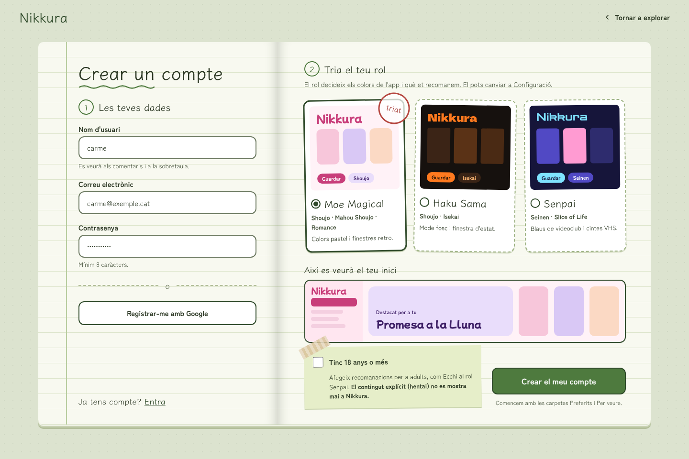

<div align="center">


<br/>

<a href="README.md"></a>
<a href="README.es.md"></a>
<a href="README.ca.md"></a>

<br/><br/>


<br/>

[](../../issues)
&nbsp;
[](../../projects)
&nbsp;
[](docs/DESIGN.md)

</div>

<br/>

> **日記蔵 · Nikkura** joins *Nikki* (日記, diary) and *Kura* (蔵, storehouse): a personal place to keep and organise the stories you watch.

> [!NOTE]
> 🚧 **In development.** The design and the foundations (milestone M0) are done: the Angular and FastAPI apps, the CI and the design tokens of the four themes. Features arrive milestone by milestone on the [project board](../../projects).

<br/>

---

##  &nbsp;What is this?

**Nikkura** is an anime discovery app where **your role shapes the whole experience**. When you sign up you pick a role (Moe Magical, Haku Sama or Senpai) and it decides the colours of the interface, the world of each anime page and the recommendations you get. Visitors can browse, search and read everything without an account.

Built as a **monorepo**: an **Angular 21** frontend that reads anime data straight from the public **Jikan API** (MyAnimeList), and a **FastAPI** backend that only stores user data (profiles, your Kura, ratings, comments and chat) in **MySQL on Aiven**, with **Firebase** authentication.

<br/>

---

##  &nbsp;Key Features

*  **Four themes:** Moe Magical, Haku Sama, Senpai and the visitor view, each with its own palette, fonts and anime page. *(design tokens ready)*
*  **Search and filters:** by title, type, genre, theme, demographic and score. *(planned · M1)*
*  **Your Kura:** folders to save anime, with your own score and a private note for each one. *(planned · M3)*
*  **Community:** public average score and comments on every anime. *(planned · M4)*
*  **Follow and share:** follow people and their folders, and recommend anime to friends. *(planned · M5)*
*  **Live chat:** a WebSocket room on each anime and private chat between friends. *(planned · M6)*
*  **Safe content:** no sexual content for anyone: hentai and erotica are never shown, and ecchi carries a +18 mark.
*  **Multilingual:** Catalan, Spanish and English. *(planned · M1)*

<br/>

---

##  &nbsp;Screenshots

*Design mockups. Every screen, on desktop and mobile, is in [`docs/DESIGN.md`](docs/DESIGN.md).*

<div align="center">
  
  &nbsp;
  
  <br/><br/>
  
  &nbsp;
  
</div>

<br/>

---

##  &nbsp;Technology Stack

| Layer | Technology |
| :--- | :--- |
|  **Frontend** | Angular 21 · standalone components · signals · SCSS with design tokens · Vitest · ESLint · Stylelint |
|  **Backend** | FastAPI · Python 3.12 · SQLAlchemy · pytest · Ruff |
|  **Database** | MySQL on Aiven (SSL) |
|  **Auth** | Firebase Authentication |
|  **Anime data** | Jikan API v4 (MyAnimeList), called from the browser |
|  **Deploy** | Render (static site + web service) · Aiven |

<br/>

---

##  &nbsp;Project Structure

<pre><code>Nikkura/
├── 🐍 backend/
│   ├── app/
│   │   ├── main.py          FastAPI app, CORS, routers
│   │   ├── core/config.py   settings, role genres, content rules
│   │   ├── routers/         endpoints (health for now)
│   │   ├── schemas/         Pydantic models
│   │   ├── models/          database tables
│   │   ├── services/        business logic
│   │   └── utils/db.py      MySQL connection
│   └── tests/
│
├── 🅰️ frontend/
│   └── src/
│       ├── styles/variables.css   all design tokens, one block per theme
│       ├── environments/          local and production settings
│       └── app/
│           ├── core/              services (ThemeService…)
│           ├── features/          one folder per screen
│           └── shared/            reusable components
│
└── 📐 docs/
    ├── DESIGN.md            roles, palettes, navigation, breakpoints, i18n
    └── screenshots/design/  mockups</code></pre>

<br/>

---

##  &nbsp;Main Endpoints

The backend grows with each milestone. The full, always up-to-date reference is the interactive documentation at `/docs`.

###  Health
<pre><code>GET    /health        → Service status and database check (200 ok · 503 degraded)</code></pre>

<br/>

---

##  &nbsp;Run Locally

### Backend

```bash
cd backend
python -m venv .venv
source .venv/bin/activate        # Windows: .venv\Scripts\activate
pip install -r requirements-dev.txt
cp .env.example .env             # Fill in the Aiven credentials
uvicorn app.main:app --reload
```

> `http://localhost:8000/health` should answer `{"status": "ok", "database": "up"}`, and `http://localhost:8000/docs` shows the API.

> [!TIP]
> On Windows, if Smart App Control or a company policy blocks SQLAlchemy (`DLL load failed`), run it in pure Python:
> PowerShell `$env:DISABLE_SQLALCHEMY_CEXT_RUNTIME = "1"` · cmd `setx DISABLE_SQLALCHEMY_CEXT_RUNTIME 1`.

### Frontend

```bash
cd frontend
npm install
npm start
```

> Open `http://localhost:4200` ✨

### Tests and lint

```bash
cd backend  && pytest -q && ruff check . && ruff format --check .
cd frontend && npm test -- --watch=false && npm run lint
```

<br/>

---

##  &nbsp;Environment Variables

Create a `.env` file in `backend/` (see `backend/.env.example`):

```env
ENVIRONMENT=local            # local or production
DB_HOST=...
DB_PORT=...
DB_NAME=nikkura
DB_USER=...
DB_PASSWORD=...
DB_SSL_CA=./ca.pem           # CA certificate from the Aiven console (never committed)
CORS_ORIGINS=http://localhost:4200
```

The frontend settings (backend URL, Jikan URL, Firebase web config) are in `frontend/src/environments/`.

<br/>

---

##  &nbsp;Workflow

*  **Gitflow:** `main` (production) · `develop` (integration) · `feature/*`, `fix/*`, `chore/*`, `docs/*` branches merged through pull requests.
*  **Conventional Commits:** `feat:`, `fix:`, `refactor:`, `chore:`, `docs:`…
*  **Planning:** issues with labels and one milestone per phase (M0 design and foundations → M7 polish), tracked on the [project board](../../projects).
*  **CI:** GitHub Actions lints, builds and tests the frontend and the backend on every pull request.
*  **Design first:** every screen was designed for the four themes before coding, see [`docs/DESIGN.md`](docs/DESIGN.md).

<br/>

---

<div align="center">

*Built to keep the anime I love in one place, and because every way of watching anime deserves its own world.* 🌸

<br/><br/>

Developed by **Carme Medina Canalda**<br/>
*Full Stack Developer · Barcelona*

<br/>

[](https://carme-portfoli.onrender.com/)
[](https://www.linkedin.com/in/carme-medina-canalda-250457132/)
[](https://github.com/mee96)

<br/>


</div>
