# Design direction

Nikkura has one layout and four looks. When a user signs up they pick a **role**, and the role decides the colours, the typography and the personality of the anime page. Visitors without an account get a fourth look of their own.

Two rules shape every screen:

- **Home: polished app.** Same structure for everyone (sidebar, search, featured anime, recommendations, trends). Only the theme tokens change.
- **Anime page: a world per role.** The detail page is where each role shows its personality, so the layout changes too. The content is always the same: cover, scores, synopsis, private note, community ratings, public comments and live chat.

## Roles

| Role | Recommendations (Jikan genres) | Palette | Anime page concept | Typefaces |
| :--- | :--- | :--- | :--- | :--- |
| 🌸 **Moe Magical** | Shoujo · Mahou Shoujo · Romance | `#FFF2F7` `#C83E7A` `#E9DDFB` `#4A2541` | Y2K desktop: every section is a retro window (`SINOPSI.TXT`, `COMUNITAT.EXE`, `XAT_EN_DIRECTE.EXE`) | Mochiy Pop One · DotGothic16 · M PLUS Rounded 1c |
| 🔥 **Haku Sama** | Shoujo · Isekai | `#120C09` `#FF7A1F` `#FFB874` `#F6EADB` | Isekai status window: stat bars, guild channel, private grimoire, rune rating | Dela Gothic One · Chakra Petch · Zen Kaku Gothic New |
| **Senpai** | Seinen · Slice of Life (+ Ecchi if 18+) | `#16153A` `#5149C4` `#7FE3FF` `#FF9BD2` | Video rental store: the anime is a VHS box, the user holds a member card, the chat plays on a CRT TV | Monoton · Zen Dots · M PLUS Rounded 1c |
| **Visitor** (no account) | Current season, all genres | `#EEF1E3` `#4E7A3E` `#E7C78E` `#2C3824` | Slice-of-life notebook: polaroid cover, hanko stamps for scores, sticky notes. Read-only, with invitations to sign up | Kiwi Maru · Klee One · Zen Kaku Gothic New |

The palette is applied with CSS custom properties switched by a `data-role` attribute on `<body>` (`moe`, `haku`, `senpai`, `guest`). Components only use tokens, never raw colours.

## Content rules shown in the UI

- Visitors can read everything (scores, comments, chat) but every action asks them to sign in.
- Private notes are only visible to their author and are marked with a lock.
- Scores show the Nikkura community average next to the MyAnimeList score.
- The live chat keeps the last 50 messages of each anime room.

## Accessibility

- Text contrast checked against WCAG AA on every theme, including the dark one.
- Touch targets of at least 44 px on mobile.
- Real `<button>`, `<a>`, `<input>` and `<label>` elements; icon-only buttons have an `aria-label`.

## Screens

### Home · desktop

| Moe Magical | Haku Sama |
| :---: | :---: |
| 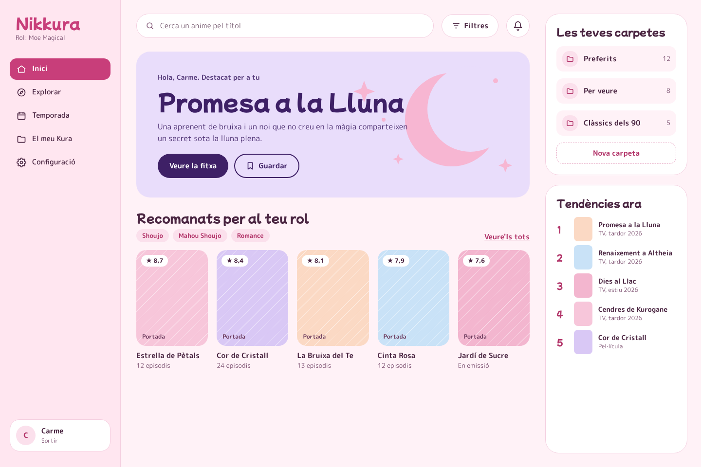 | 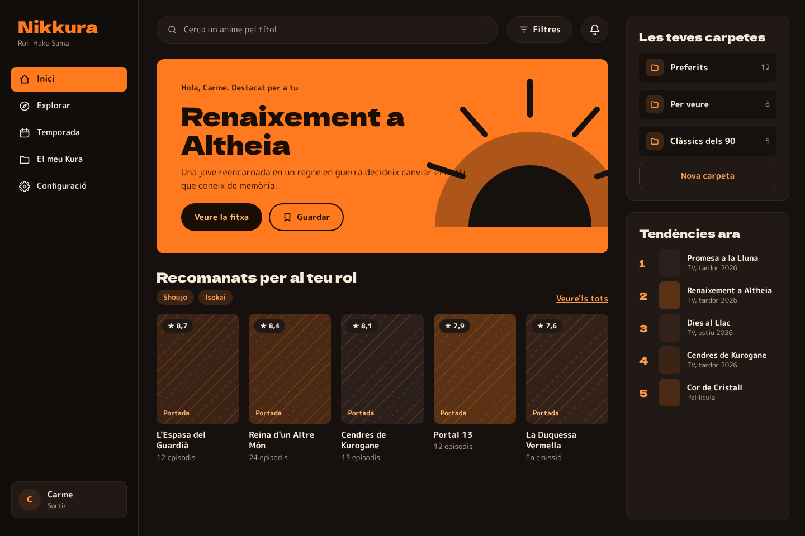 |
| **Senpai** | **Visitor** |
| 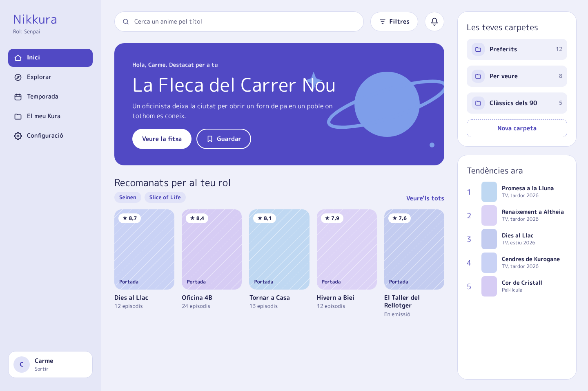 | 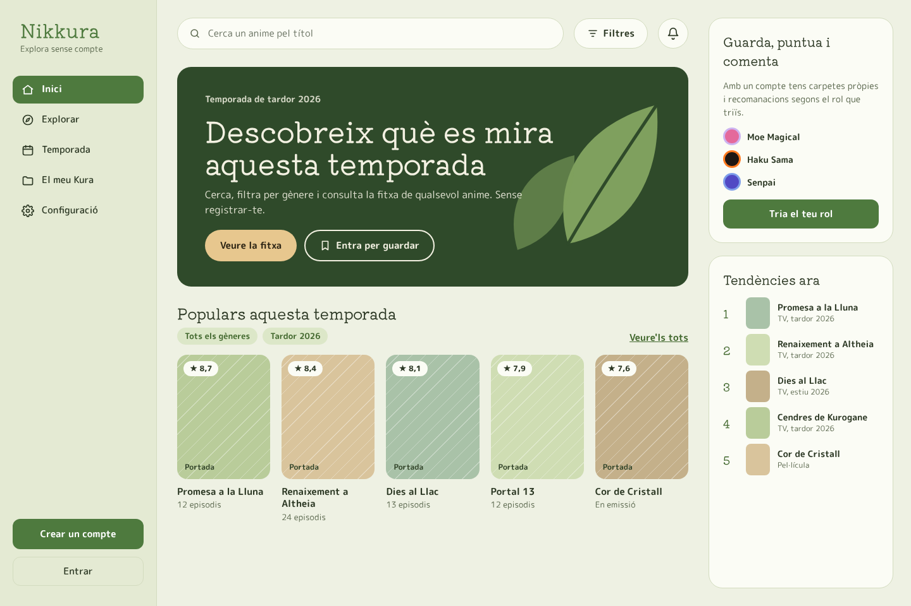 |

### Anime page · desktop

| Moe Magical | Haku Sama |
| :---: | :---: |
| 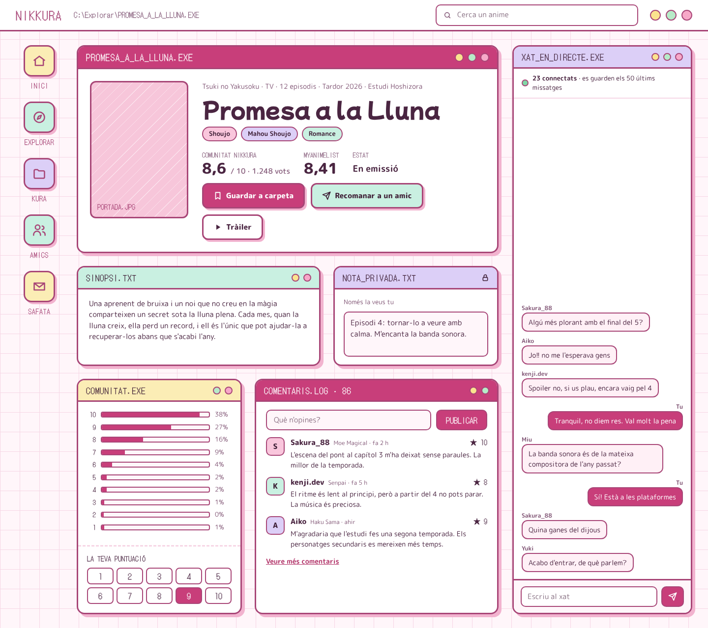 | 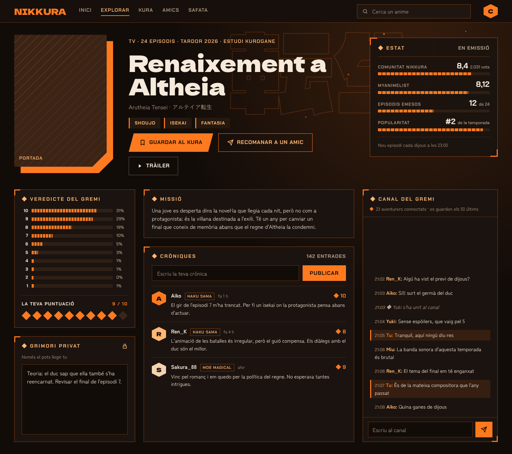 |
| **Senpai** | **Visitor** |
| 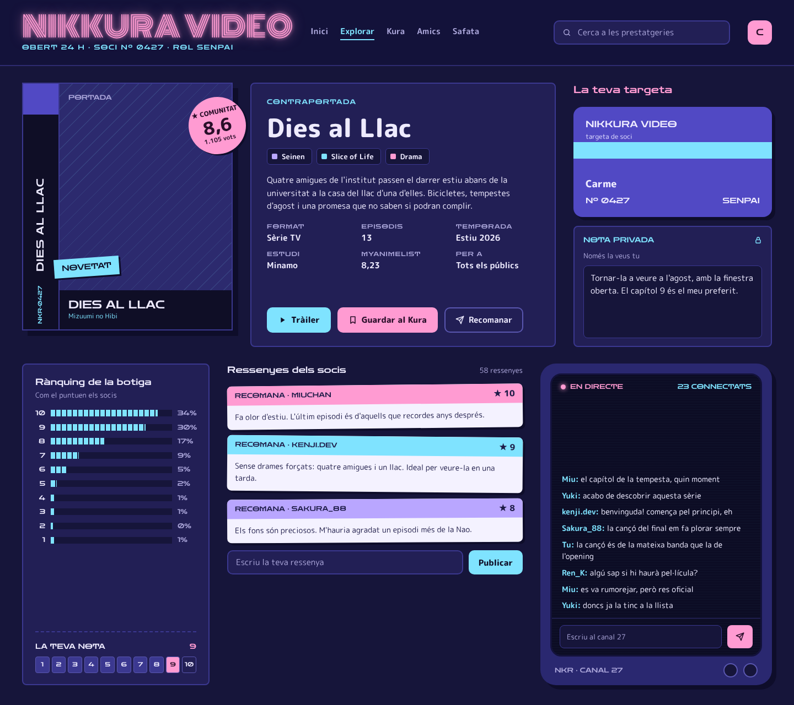 | 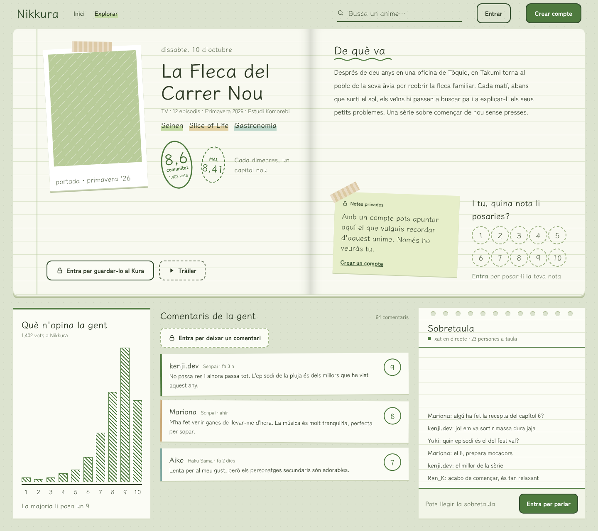 |

### Mobile

| | Moe Magical | Haku Sama | Senpai | Visitor |
| :--- | :---: | :---: | :---: | :---: |
| Home | 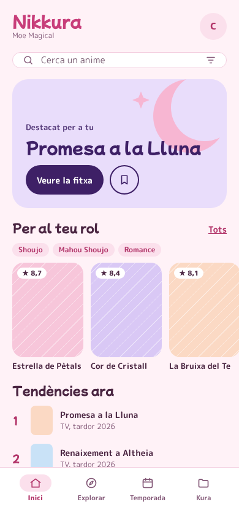 | 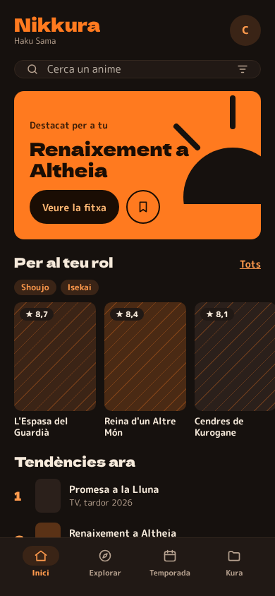 | 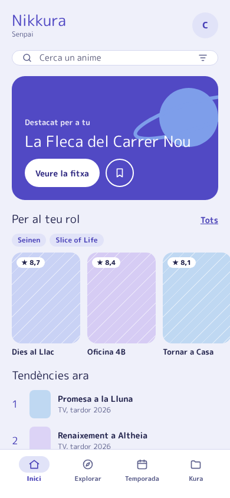 | 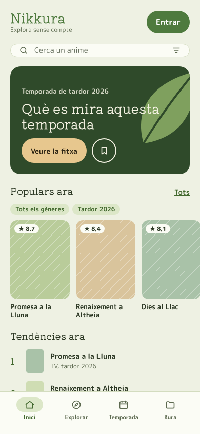 |
| Anime page | 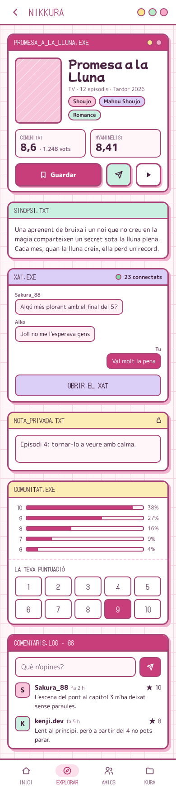 | 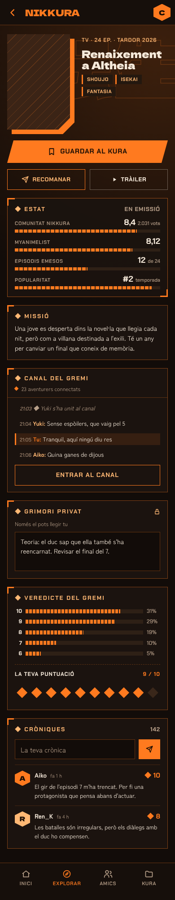 | 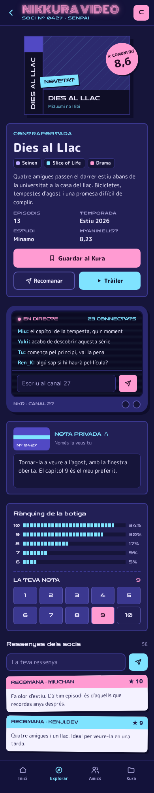 | 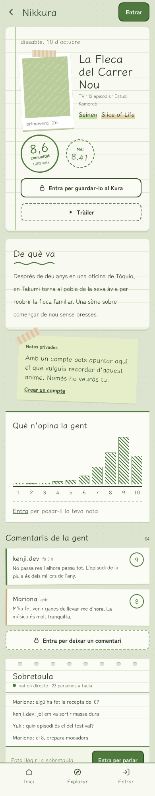 |

> Anime titles, covers and comments in the mockups are placeholders. Real data comes from the Jikan API and from Nikkura users.
