# Design direction

Nikkura has one layout and four looks. When a user signs up they pick a **role**, and the role decides the colours, the typography and the personality of the anime page. Visitors without an account get a fourth look of their own.

Two rules shape every screen:

- **Home: polished app.** Same structure for everyone (sidebar, search, featured anime, recommendations, trends). Only the theme tokens change.
- **Anime page: a world per role.** The detail page is where each role shows its personality, so the layout changes too. The content is always the same: cover, scores, synopsis, private note, community ratings, public comments and live chat.

## Roles

| Role | Recommendations (Jikan genres) | Palette | Anime page concept | Typefaces |
| :--- | :--- | :--- | :--- | :--- |
| 🌸 **Moe Magical** | Shoujo · Mahou Shoujo · Romance | `#FFF2F7` `#C83E7A` `#E9DDFB` `#4A2541` | Y2K desktop: every section is a retro window (`SINOPSI.TXT`, `COMUNITAT.EXE`, `XAT_EN_DIRECTE.EXE`) | Mochiy Pop One · DotGothic16 · M PLUS Rounded 1c |
| 📼 **Haku Sama** | Shoujo · Isekai | `#16153A` `#5149C4` `#7FE3FF` `#FF9BD2` | Video rental store: the anime is a VHS box, the user holds a member card, the chat plays on a CRT TV | Monoton · Zen Dots · M PLUS Rounded 1c |
| 🔥 **Senpai** | Seinen · Slice of Life (+ Ecchi if 18+) | `#120C09` `#FF7A1F` `#FFB874` `#F6EADB` | Status window (dark): stat bars, guild channel, private grimoire, rune rating | Dela Gothic One · Chakra Petch · Zen Kaku Gothic New |
| **Visitor** (no account) | Current season, all genres | `#EEF1E3` `#4E7A3E` `#E7C78E` `#2C3824` | Slice-of-life notebook: polaroid cover, hanko stamps for scores, sticky notes. Read-only, with invitations to sign up | Kiwi Maru · Klee One · Zen Kaku Gothic New |

The palette is applied with CSS custom properties switched by a `data-role` attribute on `<body>` (`moe`, `haku`, `senpai`, `guest`). Components only use tokens, never raw colours.

All tokens (colours, fonts, type scale, spacing, radius, shadows and motion) live in one file: [`frontend/src/styles/variables.css`](../frontend/src/styles/variables.css). The `ThemeService` sets `data-role`, and Stylelint fails the build if a component writes a raw colour. Fonts are self-hosted with Fontsource (Latin subset), so no request goes to Google Fonts.

## Content rules shown in the UI

- Visitors can read everything (scores, comments, chat) but every action asks them to sign in.
- Private notes are only visible to their author and are marked with a lock.
- Scores show the Nikkura community average next to the MyAnimeList score.
- The live chat keeps the last 50 messages of each anime room.

## Navigation

- **Desktop:** fixed sidebar with Inici, Explorar, Temporada, El meu Kura and Configuració, plus the user card at the bottom.
- **Mobile:** bottom navigation with four tabs (Inici, Explorar, Temporada, Kura). The profile and settings open from the avatar in the header.
- **Login and sign-up** have no app navigation, only a link back to exploring.

## Languages (i18n)

Nikkura is fully trilingual: **Catalan, Spanish and English**. Every piece of UI text is a translation key, never a hard-coded string, from the first component.

- The first visit uses the browser language (Catalan, Spanish or English, with English as fallback). Once chosen, the language is saved in the user's profile; visitors keep it in the browser.
- **Desktop:** CA · ES · EN switch at the bottom of the sidebar. **Login and sign-up:** switch in the header. **Mobile:** language button in the login and sign-up header, and in Configuració inside the app.
- The `<html lang>` attribute changes with the language, and each option is labelled in its own language (Català, Castellano, English).
- "Kura" is a name and is never translated. Genre names come from Jikan in English and are translated with our own table.
- Catalan and Spanish texts are usually 20–30% longer than English, so buttons and chips grow with their content and never use fixed widths.
- The mockups are drawn in Catalan.

## Breakpoints

| Name | Width | Layout |
| :--- | :--- | :--- |
| Mobile | < 768 px | Bottom navigation, one column, 2-column cover grids, filters in a bottom sheet |
| Tablet | 768–1199 px | Sidebar collapsed to an icon rail, filters in a sheet, 3–4 column grids |
| Desktop | ≥ 1200 px | Full 248 px sidebar, filters panel next to the results, 5–6 column grids |

The mockups are drawn at 390 px (mobile) and 1440 px (desktop).

## Accessibility

- Text contrast checked against WCAG AA on every theme, including the dark one. Placeholders use the full muted colour, never a lower opacity.
- Touch targets of at least 44 px on mobile.
- Real `<button>`, `<a>`, `<input>` and `<label>` elements; icon-only buttons have an `aria-label`.
- Filter chips are toggle buttons (`aria-pressed`), the role picker is a radio group inside a `<fieldset>`, and folders in the Kura are tabs.

## Screens

### Home · desktop

| Moe Magical | Haku Sama |
| :---: | :---: |
|  |  |
| **Senpai** | **Visitor** |
|  |  |

### Anime page · desktop

| Moe Magical | Haku Sama |
| :---: | :---: |
|  |  |
| **Senpai** | **Visitor** |
|  |  |

### Mobile

| | Moe Magical | Haku Sama | Senpai | Visitor |
| :--- | :---: | :---: | :---: | :---: |
| Home |  |  |  |  |
| Anime page |  |  |  |  |

### Search and filters

Text search plus filters by type, genre, theme, demographic and minimum score. Active filters show as removable chips above the results, and a note reminds that explicit content is never shown. On mobile the filters open in a bottom sheet. Shown in Moe Magical and Haku Sama, as these screens only change theme tokens.

| Desktop · Moe Magical | Desktop · Haku Sama |
| :---: | :---: |
| 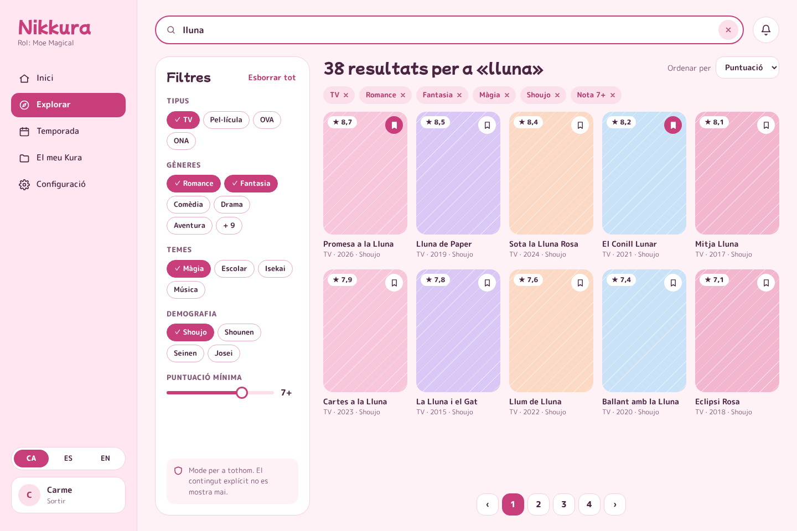 | 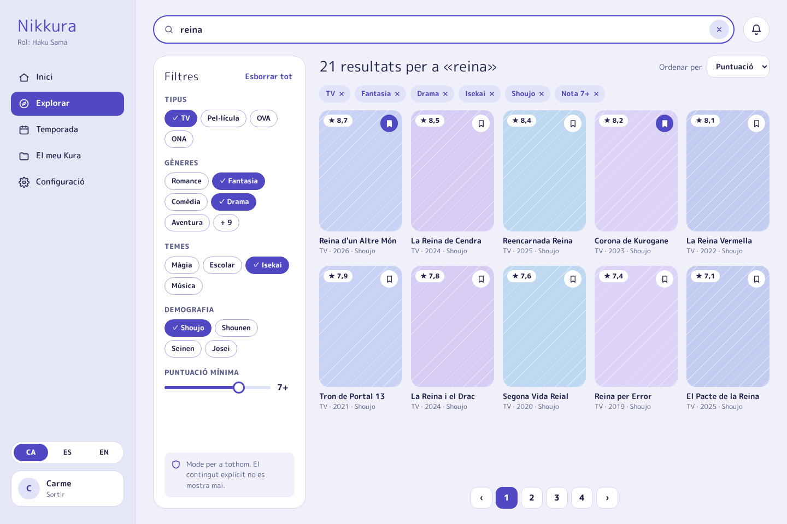 |

| Mobile · Moe Magical | Mobile · Haku Sama | Filter sheet |
| :---: | :---: | :---: |
| 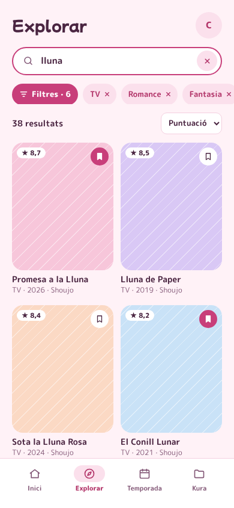 | 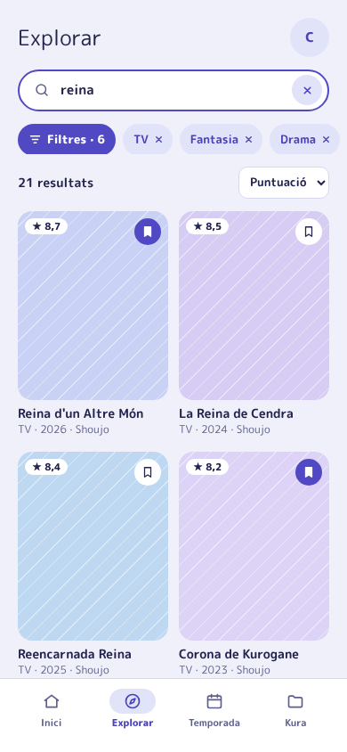 | 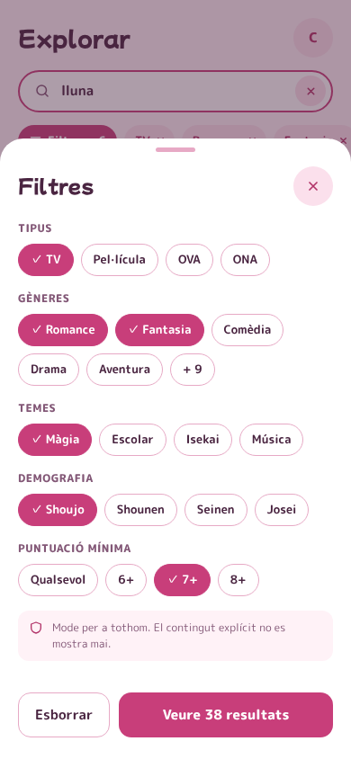 |

### Kura

The personal library. Folders sit on top as tabs; each one shows how many anime it holds and who can see it (only me, followers or everyone). The two default folders, Preferits and Per veure, are marked and cannot be deleted. Every saved anime shows the user's own score and a lock when it has a private note.

| Desktop · Moe Magical | Desktop · Haku Sama |
| :---: | :---: |
| 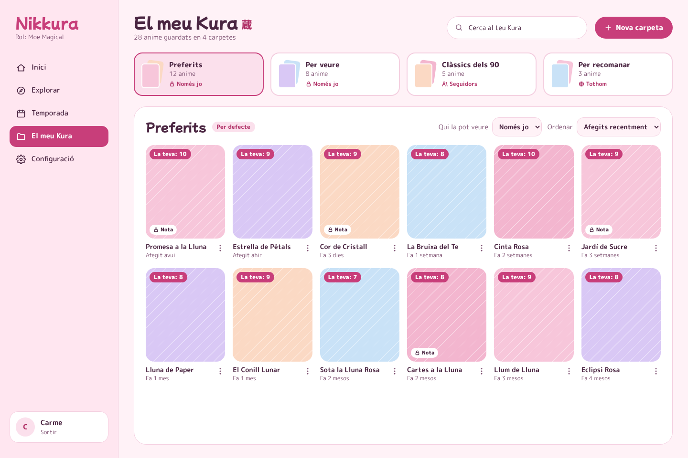 | 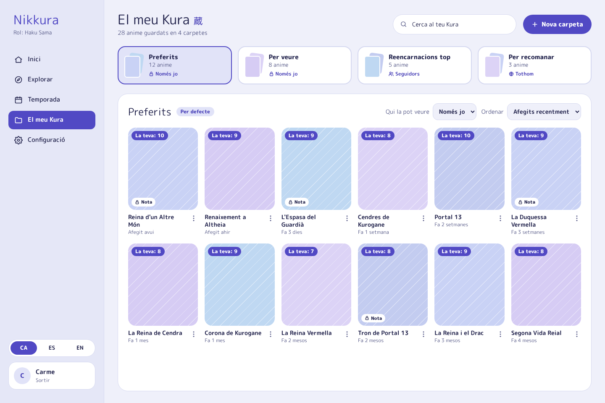 |

| Mobile · Moe Magical | Mobile · Haku Sama |
| :---: | :---: |
| 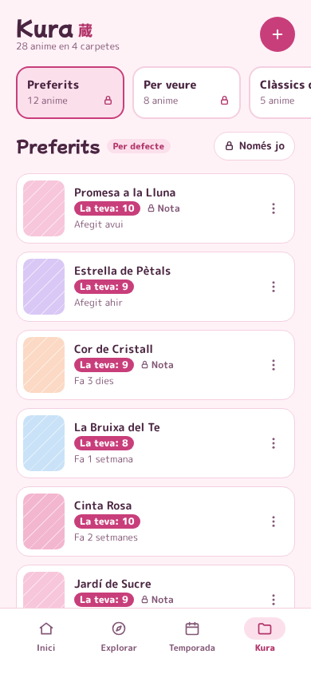 | 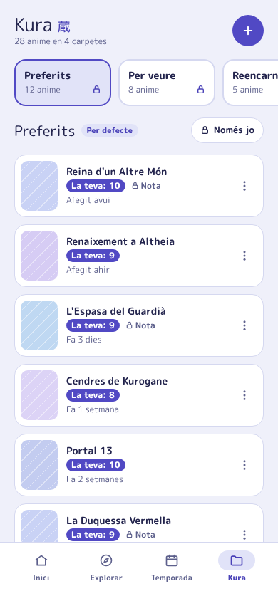 |

### Login and sign-up

Both use the visitor look (green notebook), because the person has no role yet. Sign-up asks for the account details and the role on the same spread on desktop, and in two steps on mobile. Each role card previews its own theme, and the selected one is shown as a preview of the user's home. The 18+ option is off by default and explains that hentai is never shown.

| Login · desktop | Sign-up · desktop |
| :---: | :---: |
| 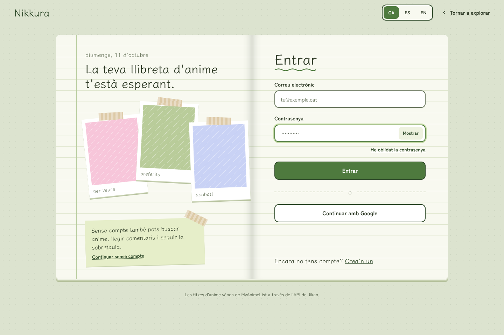 |  |

| Login · mobile | Sign-up, step 2 · mobile |
| :---: | :---: |
| 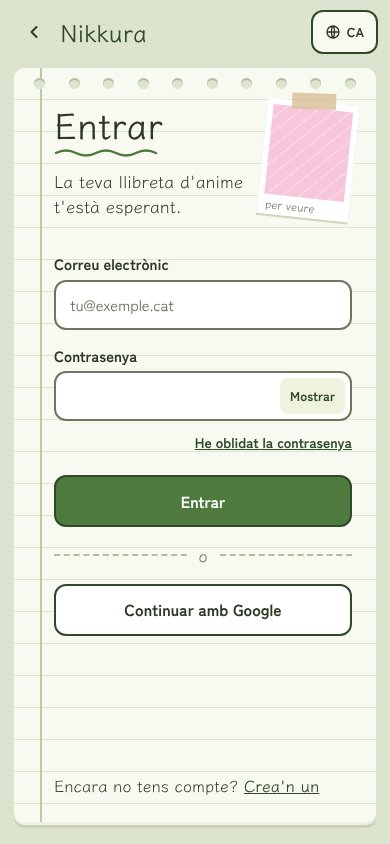 | 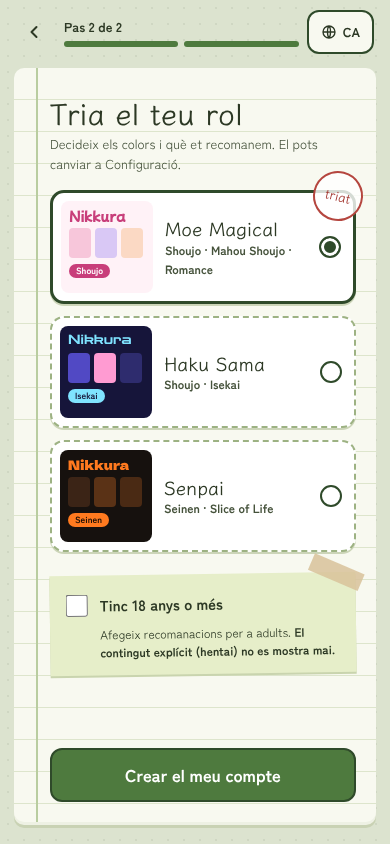 |

> Anime titles, covers and comments in the mockups are placeholders. Real data comes from the Jikan API and from Nikkura users.
